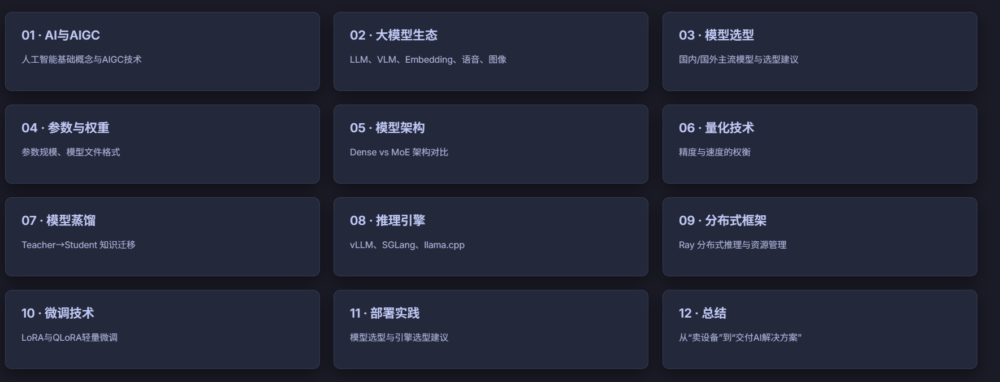

# AI



# AI与AIGC

## AI

- 传统意义上的AI就是一堆if else判断语句，只会给你自己有的，不会向外部探索以及自己思考

## AIGC

- 新的AI，可以利用大模型作为引擎，通过语言提示，自动生成内容

- 底层逻辑：模型通过学习海量数据中的模式和规律，具备“创造”新内容的能力，而非简单复制或分类。

- 应用场景：文本，视频，图片，代码，数字人

# 大模型生态

## 什么是大模型（LLM）

- 大模型（Large Language Model，大语言模型）是通过海量数据（数万亿Token）训练得到的通用智能模型。它的核心特点是参数规模巨大（数十亿到数千亿）和训练数据广泛（涵盖互联网、书籍、代码、对话等）。

- 大模型不只是“更大的模型”，它是 AI 从“专用工具”进化为“通用智能”的转折点——一个模型可以完成多种任务，无需针对每个任务单独训练

## 大模型分类

- LLM：语言模型

- VLM：视觉语言模型

- Embedding：向量模型

    - 将文本/图片转换为高维向量（Vector/Embedding）。向量之间的距离代表语义相似度。

    - 核心用途：

    RAG知识库 — 检索相似文档

    相似度搜索 — 语义匹配

    推荐系统 — 内容向量化推荐

- Reranker：重排模型

    - 对Embedding模型检索出来的Top\-K结果，进行**二次精排序**，剔除低相关性结果。

    - 核心用途：

    提升RAG准确率 — 过滤无关文档

    精确排序 — 重排序Top\-K结果

    优化召回质量

- 语音模型

    - ASR：语音转文字

    - TTS：文字转语音

- 图像生成模型：根据文本描述生成图像

# DENSE与MOE架构

## Dense模型（稠密模型）

- 全部参数参与计算

## MOE模型（稀疏模型/混合专家模型）

- 部分参数参与计算

# 模型精度（量化）

- FP16：模型计算以16位进行，此时35B需要70G显存

- FP8：模型计算以16位进行，此时35B需要35G显存

- FP8比FP16精度小，速度快。但是FP16结果更精确，FP8能达到FP16大约90%性能。FP多少就是以多少进制位单位进行计算。

- NVFP4：按理说8进制是能接受的最小的范围，但是NVIDIA出了以4进制进行运算。他在4进制的过程中，每几段运算参加16进制运算，达到模型小但是运算精确提高的效果。

    - blackwell架构：只有新出的NVIDIA显卡才支持NVFP4

## 混合精度模型

- 模型中不同层用不同的量化精度

    - 保持高精度，减少现存和计算量

# 模型蒸馏

- 通过大量数据集训练出大模型，然后通过大模型教给空容量的小模型专门的内容

- 蒸馏会保证小模型学习大模型的思考过程以及内容，拥有90%大模型的性能

- 蒸馏容量越小，损失内容越多，蒸馏一般选取满血版大模型

# AI开发示例

- 创建一个项目文件夹并且编写md文件

```XML
# 多人联机坦克大战游戏

- 技术栈，flask + websocket + html5 canvas
- 实现多人访问网页，可以在一个较大的，并且有随机掩体的地图中互相移动攻击
- 需要有多种道具可以增加玩家的能力
- 需要有排名功能，玩家可以根据自己的成绩和排名进行比较
- 需要有小地图，可以标注玩家的位置和移动方向
```

- 将自己的`需求.md`文件拖入对话框

```XML
实现这个代码，使用python虚拟环境，pip安装包需要清华源，规划好开发步骤，建立智能体小组，并发进行开发测试任务
```


